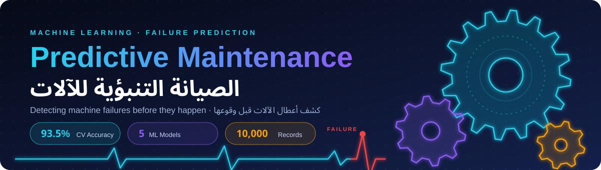
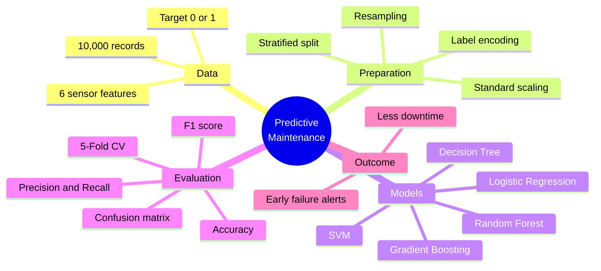
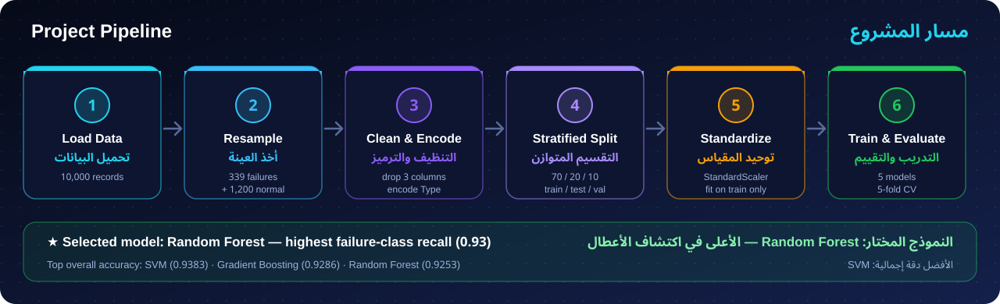
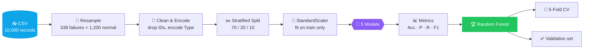
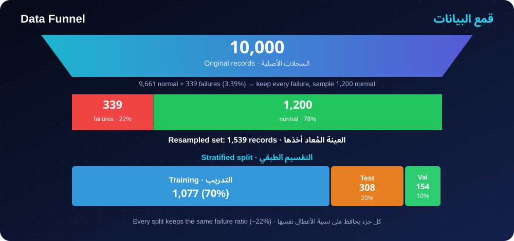
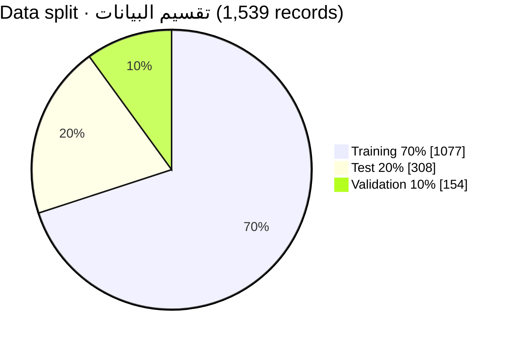
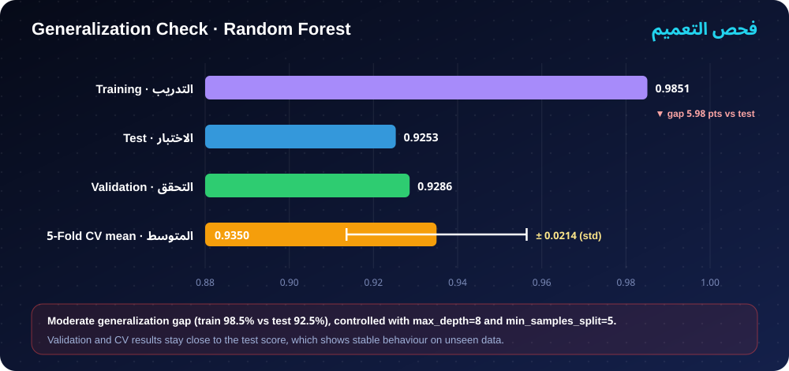
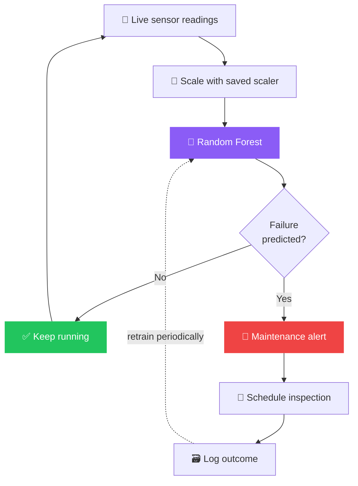
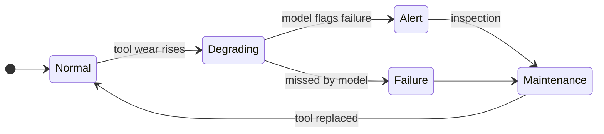

<div align="center">



<br/>


### 🔧 نظام ذكي للتنبؤ بأعطال الآلات الصناعية قبل وقوعها
### Machine-learning system that predicts industrial machine failures before they happen

[العربية](#-نظرة-عامة) · [English](#-overview) · [النتائج / Results](#-النتائج--results) · [التشغيل / Quick Start](#-التشغيل-السريع--quick-start)

</div>

---

## 🎯 نظرة عامة

توقف آلة واحدة في خط الإنتاج قد يكلف وقتاً ومالاً كبيرين. بدلاً من الانتظار حتى يحدث العطل (صيانة تصحيحية) أو الصيانة بجدول ثابت (صيانة وقائية)، يستخدم هذا المشروع **قراءات الحساسات** (الحرارة، سرعة الدوران، عزم الدوران، تآكل الأداة) لتدريب نماذج تعلّم آلي تتنبأ **هل ستتعطل الآلة أم لا**.

يقارن المشروع **5 خوارزميات** تصنيف، ويقيّمها بمقاييس متعددة، ويفحص قدرة النموذج الأفضل على التعميم بالتحقق المتقاطع (5-Fold CV) ومجموعة تحقق مستقلة.

## 🎯 Overview

An unplanned machine stop is expensive. Instead of reacting after a failure or servicing on a fixed calendar, this project learns from **sensor readings** (temperatures, rotational speed, torque, tool wear) to predict **whether a machine is about to fail**.

It benchmarks **5 classifiers**, evaluates them on several metrics, and checks the best model's generalization with 5-fold cross-validation and a held-out validation set.

<div align="center">

| 🗂️ Records | ⚙️ Features | 🤖 Models | 🏆 CV Accuracy | 🎯 Failure Recall (RF) |
|:---:|:---:|:---:|:---:|:---:|
| **10,000** | **6** | **5** | **93.5% ± 2.1%** | **0.93** |

</div>

---

## 🧠 خريطة المشروع | Project Mind-Map



---

## 🔄 مسار العمل | Workflow

<div align="center">

</div>



---

## 📦 البيانات | Dataset

مجموعة بيانات صيانة تنبؤية من **10,000 سجل** و**10 أعمدة**، كل سجل يمثل آلة بقراءات حساساتها وحالة العطل.
A predictive-maintenance dataset of **10,000 records** and **10 columns**; each row is a machine with its sensor readings and failure status.

<div align="center">

</div>

| Column | العمود | Role / الدور |
|---|---|---|
| `Type` | نوع الآلة | Feature · label-encoded |
| `Air temperature [K]` | حرارة الهواء | Feature |
| `Process temperature [K]` | حرارة التشغيل | Feature |
| `Rotational speed [rpm]` | سرعة الدوران | Feature |
| `Torque [Nm]` | عزم الدوران | Feature |
| `Tool wear [min]` | تآكل الأداة | Feature |
| `Target` | حالة العطل | **Label** · 0 = normal, 1 = failure |
| `UDI`, `Product ID` | الرقم التسلسلي، معرف المنتج | Dropped (identifiers) |
| `Failure Type` | نوع العطل | Dropped (it reveals the label, so keeping it would leak the answer) |

### ⚖️ معالجة عدم التوازن | Handling class imbalance

الأعطال نادرة (**339 فقط = 3.39%**). لذلك أُبقيت **كل** سجلات الأعطال وسُحبت عينة عشوائية من **1,200** سجل سليم، فارتفعت نسبة الأعطال إلى نحو **22%** لتتعلم النماذج أنماطها.
Failures are rare (**339 = 3.39%**). All failure rows are kept and **1,200** normal rows are sampled, raising the failure share to about **22%** so models can learn failure patterns.

<div align="center">

</div>



> التقسيم **طبقي (stratified)**: كل جزء يحتفظ بنفس نسبة الأعطال تقريباً. والـ `StandardScaler` يُضبط على بيانات التدريب فقط ثم يُطبّق على الاختبار والتحقق لمنع تسرب المعلومات.
> The split is **stratified**, and the `StandardScaler` is fitted on training data only, then applied to test/validation to avoid data leakage.

---

## 🤖 النماذج | Models

| # | Model | Key hyper-parameters |
|:-:|---|---|
| 1 | Logistic Regression | `C=1.0` |
| 2 | Decision Tree | `max_depth=5`, `min_samples_split=10` |
| 3 | Random Forest | `n_estimators=100`, `max_depth=8`, `min_samples_split=5` |
| 4 | Gradient Boosting | `n_estimators=100`, `max_depth=3`, `learning_rate=0.1` |
| 5 | Support Vector Machine | `kernel='rbf'`, `C=1.0` |

كل النماذج استخدمت `random_state=42` لضمان تكرار النتائج. · All models use `random_state=42` for reproducibility.

---

## 📊 النتائج | Results

<div align="center">

</div>

### جدول المقارنة (بيانات الاختبار · 308 سجل) | Test-set comparison

| Model | Accuracy | F1 (weighted) | Failure Precision | Failure Recall | Failure F1 |
|---|:-:|:-:|:-:|:-:|:-:|
| **SVM** | **0.9383** | **0.9375** | **0.89** | 0.82 | 0.85 |
| Gradient Boosting | 0.9286 | 0.9300 | 0.80 | 0.90 | 0.85 |
| **Random Forest** ⭐ | 0.9253 | 0.9275 | 0.78 | **0.93** | 0.85 |
| Decision Tree | 0.9221 | 0.9221 | 0.82 | 0.82 | 0.82 |
| Logistic Regression | 0.8864 | 0.8810 | 0.81 | 0.63 | 0.71 |

### 💡 لماذا Random Forest؟ | Why Random Forest?

في الصيانة التنبؤية، **تفويت عطل حقيقي أغلى بكثير من إنذار كاذب**. الـ SVM الأعلى دقة إجمالية، لكن Random Forest الأعلى في **استرجاع الأعطال (Recall = 0.93)**، أي يلتقط نحو **63 من أصل 68** عطلاً في مجموعة الاختبار. لذلك اعتُمد نموذجاً نهائياً.

In predictive maintenance, **missing a real failure costs far more than a false alarm**. SVM has the best overall accuracy, but Random Forest has the best **failure recall (0.93)**, catching roughly **63 of the 68** failures in the test set, so it was selected as the final model.

### ✅ التحقق النهائي | Final validation

<div align="center">

</div>

| Check | Accuracy | F1 |
|---|:-:|:-:|
| Training set | 0.9851 | 0.9851 |
| Test set | 0.9253 | 0.9275 |
| Validation set (154 records) | 0.9286 | 0.9289 |
| 5-Fold CV (mean ± std) | 0.9350 ± 0.0214 | n/a |

> **ملاحظة صريحة:** الفارق بين التدريب (98.5%) والاختبار (92.5%) نحو **6 نقاط**، أي وجود **فرط ملاءمة معتدل**. هو مضبوط بتحديد عمق الأشجار (`max_depth=8`)، ونتائج التحقق والـ CV قريبة من الاختبار، فالنموذج مستقر على بيانات جديدة.
> **Honest note:** the train/test gap is about **6 points**, so there is **moderate overfitting**. It is limited by depth constraints, and validation and CV scores stay close to the test score, so the model behaves consistently on unseen data.

---

## 🏭 تصور للتطبيق العملي | Proposed Deployment Flow

> هذا تصور مقترح للتوسع المستقبلي، وهو غير منفّذ في الـ notebook الحالي.
> A proposed future extension; it is not implemented in the current notebook.





---

## 🚀 التشغيل السريع | Quick Start

```bash
# 1) Clone
git clone https://github.com/r6pfmbzkk9-stack/-.git predictive-maintenance
cd predictive-maintenance

# 2) Install
pip install -r requirements.txt

# 3) Add the dataset (not included in the repo)
#    place predictive_maintenance.csv next to the notebook

# 4) Open the notebook
jupyter notebook
```

⚠️ **مهم قبل التشغيل | Before you run:** في الخلية الثانية غيّر مسار الملف إلى مسار نسبي.
In the second cell, change the file path to a relative one:

```python
file_path = 'predictive_maintenance.csv'
```

### 📁 هيكل المشروع | Structure

```text
.
├── README.md
├── requirements.txt
├── الصيانة التنوية للالات.ipynb     # main notebook · الدفتر الرئيسي
├── predictive_maintenance.csv       # add locally · أضفه محلياً
├── banner.svg                       # README illustrations · رسومات الشرح
├── pipeline.svg
├── funnel.svg
├── feature map.svg
├── model comparison.svg
└── generalization.svg
```

---

## 🔭 التطوير المستقبلي | Roadmap

- [ ] Hyper-parameter tuning with `GridSearchCV` / `RandomizedSearchCV`
- [ ] Handle imbalance with `class_weight` or SMOTE instead of manual sampling
- [ ] Add ROC-AUC and Precision-Recall curves
- [ ] Feature importance and SHAP explanations
- [ ] Multi-class prediction of the failure type (`Failure Type`)
- [ ] Save the scaler and model with `joblib`, then serve them through a small API or dashboard

## ⚠️ حدود المشروع | Limitations

- **العينة:** العينة المُعاد أخذها (1,539) أصغر بكثير من البيانات الأصلية ونسبة الأعطال فيها (~22%) أعلى من الواقع (3.39%)، فقد لا تنتقل المقاييس كما هي إلى الإنتاج.
  **Sample:** the resampled set (1,539) is much smaller than the raw data and has a higher failure share (~22%) than reality (3.39%), so metrics may not transfer directly to production.
- **التحقق:** مجموعة التحقق صغيرة (154 سجل)، فتقديرها عرضة للتذبذب.
  **Validation:** the validation set is small (154 records), so its estimate is noisy.

---

<div align="center">

**صُنع بشغف لعالم الصيانة الذكية · Built with ❤️ for smarter maintenance**

⭐ إذا أعجبك المشروع، لا تنسَ نجمة · Star the repo if you like it

</div>
